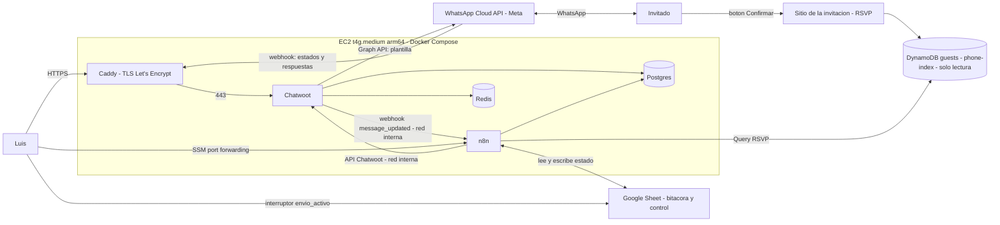
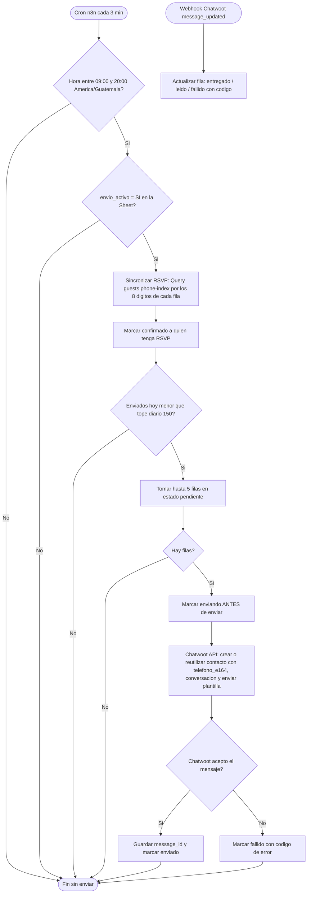
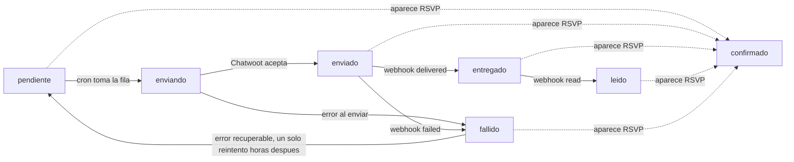

# send-invites

Envío automatizado y trazable del **recordatorio de la invitación** a la fiesta de los 60 años de Rodolfo, a los invitados que aún no confirman (88 de 123 al 2026-11-15), mediante la **API oficial de WhatsApp (Cloud API de Meta)**, con **n8n** como orquestador y **Chatwoot** como bandeja de conversaciones.

> Estado: **Paso 1 de Meta completado** (portafolio, app, WABA de prueba, 2FA y método de pago). Siguiente: plantilla del recordatorio y chip dedicado.

---

## 1. Contexto y problema

- La invitación ya se envió una primera vez por WhatsApp desde números personales.
- No quedó bitácora: no se sabe quién la recibió. Parte de los mensajes se borró.
- WhatsApp bloqueó 2 números durante 24 h por envío masivo desde la app normal.

**Objetivo:** enviar un recordatorio con **control** (quién lo recibió, quién lo leyó, quién falló), **sin intervención manual**, **sin duplicados** y **sin riesgo de bloqueo**, y no molestar a quien ya confirmó asistencia.

## 2. Decisiones y por qué

| Decisión | Motivo |
|---|---|
| **API oficial (WhatsApp Cloud API de Meta)**, sin Baileys, whatsapp-web.js ni Evolution API | Las librerías no oficiales simulan WhatsApp Web y son las que provocan bloqueos. La API oficial da estados de entrega por webhook. |
| **Número dedicado (chip nuevo)** | Un número registrado en la Cloud API deja de funcionar en la app. Los 2 números bloqueados tienen mala reputación reciente. La coexistencia (app y API en el mismo número) requiere ser Solution Partner o Tech Provider y está en beta. |
| **EC2 aislada** con n8n y Chatwoot, en un proyecto propio | No toca el stack de la invitación (`rodolfo-invite`). Tiene su propio Terraform y su propio state, y se destruye completa después de la fiesta. |
| **Chatwoot es el único dueño del webhook de Meta** | Meta envía estados y respuestas a un solo callback por número. Si n8n enviara directo a la Graph API, Chatwoot no conocería el mensaje y n8n no recibiría los estados. |
| **n8n envía a través de la API de Chatwoot**, no directo a Meta | Cada recordatorio queda como primer mensaje de su conversación en Chatwoot, con su estado y las respuestas encadenadas. |
| **Google Sheet como bitácora y control** | Es visible desde el celular, tiene una fila por invitado e incluye el interruptor de emergencia. |
| **Envío automático por cron, idempotente** | No requiere intervención de Luis. La máquina de estados garantiza un solo recordatorio por persona. |

## 3. Arquitectura

Fuente: [`docs/arquitectura.mmd`](docs/arquitectura.mmd)

## 4. Flujo de envío (cron cada 3 minutos)

Fuente: [`docs/flujo-envio.mmd`](docs/flujo-envio.mmd)

Con 5 envíos cada 3 minutos, los 88 pendientes se procesan en unos 54 minutos. Cuando no quedan filas `pendiente`, el cron sigue corriendo sin enviar nada.

## 5. Máquina de estados por invitado

Fuente: [`docs/estados.mmd`](docs/estados.mmd)

### Protecciones (sin intervención manual)

- **Un solo recordatorio por persona:** solo las filas `pendiente` pasan a envío, y ninguna vuelve a ese estado salvo por el reintento único.
- **Marcar `enviando` antes de enviar:** si dos ejecuciones se cruzan, nadie recibe el mensaje dos veces.
- **Reintento único:** solo para errores recuperables, horas después, y se controla con la columna `intentos`. Por ejemplo, el 131049 (Meta no entrega marketing por saturación del usuario) no se reintenta de inmediato. Los errores definitivos se quedan en `fallido` para revisión.
- **Interruptor de emergencia:** la celda `envio_activo = SI/NO` de la Sheet detiene todo desde el celular.
- **Tope diario de 150:** queda por debajo del límite de Meta de 250 destinatarios únicos cada 24 h para portafolios nuevos.
- **Horario:** solo de 09:00 a 20:00, hora de Guatemala.
- **Sincronización de RSVP:** quien confirma en el sitio pasa a `confirmado` y no recibe nada más.

## 6. Datos

### Google Sheet (bitácora y control)

| Columna | Descripción |
|---|---|
| `nombre` | Nombre del invitado (variable `{{1}}` de la plantilla) |
| `telefono8` | Últimos 8 dígitos, la misma normalización que `rodolfo-invite`. Solo sirve para cruzar con el RSVP, no para enviar |
| `telefono_e164` | Número completo con código de país, tal como viene del CSV: `+502` + 8 dígitos (Guatemala) o `+1` + 10 dígitos (EE. UU.). **No** se arma como `502` + `telefono8` |
| `invitados` | Cupo de la invitación |
| `estado` | `pendiente`, `enviando`, `enviado`, `entregado`, `leido`, `fallido` o `confirmado` |
| `intentos` | Número de envíos (máximo 2) |
| `message_id` | ID del mensaje de WhatsApp (wamid) |
| `error` | Código y detalle del fallo |
| `actualizado` | Fecha y hora del último cambio |

Una hoja aparte, `control`, con `envio_activo` (SI/NO) y `tope_diario` (150).

### DynamoDB (proyecto `rodolfo-invite`, solo lectura)

- **Invitaciones (lista de permitidos):** tabla `rodolfo-invite-invitations-prod`, clave `phoneKey` (últimos 8 dígitos), con `invitedName`, `maxGuests` y `phoneOriginal`. Es la que valida el RSVP (`backend/src/lib/invitations.js`). Al 2026-11-15 tiene 123 invitaciones.
- **RSVP:** tabla `<project>-guests-<env>`, GSI `phone-index`. El campo `phone` guarda **solo los últimos 8 dígitos** (ver `backend/src/utils/phone.js` en `rodolfo-invite`). n8n consulta con esos 8 dígitos.
- **Permiso IAM mínimo:** `dynamodb:Query` sobre `arn:...:table/<project>-guests-<env>/index/phone-index`. Se usará el rol de la instancia si el nodo de n8n lo soporta; si no, un usuario IAM con solo ese permiso.

### Origen de los invitados

La lista sale de cruzar las dos tablas: las invitaciones (123) menos las que ya tienen RSVP en `guests` (35 al 2026-11-15), comparando por los últimos 8 dígitos. El resultado es `csv/recordatorio-2026-11-15.csv`:

- Formato `Nombre,Telefono,Invitados`, con el teléfono completo con código de país.
- 88 filas: 62 de Guatemala (`+502` + 8 dígitos) y 26 de EE. UU. (`+1` + 10 dígitos, que en `phoneOriginal` vienen sin el `1`).

Se carga una vez en la Sheet con `estado = pendiente`. **Los CSV no se versionan:** contienen datos personales y `*.csv` está en `.gitignore`.

## 7. Infraestructura y seguridad

- **Cuenta y región:** las mismas de `rodolfo-invite`. Se confirma con `aws sts get-caller-identity` antes de cualquier plan.
- **EC2 t4g.medium (arm64, 4 GB)** con Docker Compose. Las imágenes se fijan por versión, sin `latest`. Falta confirmar que Chatwoot publique imágenes arm64.
- **Expuesto a internet:** solo 443 (y 80 para el reto HTTP de Let's Encrypt), con Caddy por delante y solo hacia **Chatwoot** (`chat.<dominio>`), porque es quien recibe el webhook de Meta.
- **n8n no se expone:** se accede por SSM port forwarding.
- **Sin puerto 22:** el acceso a la instancia es por SSM Session Manager.
- **Webhook de Meta:** se valida la firma `X-Hub-Signature-256`.
- **Token de Meta:** token de System User con permisos mínimos (`whatsapp_business_messaging`, `whatsapp_business_management`) y nunca el token temporal. Se guarda en Secrets Manager o en la configuración cifrada de Chatwoot, nunca en el repo.
- **Terraform propio** en este repo: backend remoto con bloqueo y cifrado, providers fijados, sin secretos en `.tfvars` versionados. Se destruye al terminar.

## 8. Plantilla del recordatorio (borrador pendiente)

Definición completa, motivos y pendientes: [`docs/plantilla.md`](docs/plantilla.md).

- Categoría esperada: **Marketing**. Meta decide la categoría al revisarla.
- Variable `{{1}}`: nombre del invitado.
- Botón URL 1: **Confirmar asistencia**, que lleva al sitio de la invitación (el RSVP queda en DynamoDB).
- Botón URL 2: **Escribirme**, `wa.me/502XXXXXXXX` al número personal de Luis, para dudas.
- El texto aclara que el número solo envía recordatorios.

## 9. Plan de trabajo

- [x] **Meta, paso 1:** 2FA, portafolio comercial, app con caso de uso WhatsApp, WABA con número de prueba y método de pago.
- [ ] **Plantilla:** redactar, revisar y enviar a aprobación.
- [ ] **Chip dedicado:** registrar el número en la WABA, aprobar el nombre visible y crear el token de System User.
- [ ] **Verificaciones previas:** confirmar que la API de Chatwoot acepta `template_params` en WhatsApp Cloud, que existen imágenes arm64 de Chatwoot y que el nodo DynamoDB de n8n soporta el rol de instancia.
- [ ] **Terraform de la EC2:** VPC/SG, rol IAM, SSM y DNS `chat.<dominio>`. Con fmt, validate, plan, revisión y apply solo con autorización.
- [ ] **Docker Compose:** Caddy, Chatwoot, Postgres, Redis y n8n, con versiones fijadas.
- [ ] **Bandeja WhatsApp Cloud en Chatwoot** y webhook de Meta apuntando a Chatwoot.
- [ ] **Google Sheet:** carga inicial desde el CSV y credenciales OAuth de n8n.
- [ ] **Flujo n8n:** cron, sincronización de RSVP, envío y webhook de estados.
- [ ] **Prueba controlada:** 2 o 3 números propios en la Sheet antes de cargar a los 88 pendientes.
- [ ] **Envío real:** activar `envio_activo = SI` y monitorear.
- [ ] **Cierre:** `terraform destroy` (con autorización), exportar la bitácora y verificar que no queden recursos.

## 10. Pendientes por verificar

- Tarifa exacta por mensaje de marketing en el rate card de Meta para los dos destinos: Guatemala ("Rest of Latin America", 62 números) y EE. UU. ("North America", 26 números). Meta cobra según el código de país del destinatario.
- Si Meta clasifica la plantilla como Marketing o como Utility.
- Si una plantilla se puede crear y aprobar en la WABA antes de registrar el número real.

## 11. Fuentes

- [WhatsApp Cloud API: Get Started](https://developers.facebook.com/documentation/business-messaging/whatsapp/get-started)
- [Pricing on the WhatsApp Business Platform](https://developers.facebook.com/documentation/business-messaging/whatsapp/pricing)
- [Messaging Limits](https://developers.facebook.com/documentation/business-messaging/whatsapp/messaging-limits)
- [Throughput](https://developers.facebook.com/documentation/business-messaging/whatsapp/throughput/)
- [Template fundamentals](https://developers.facebook.com/documentation/business-messaging/whatsapp/templates/overview.md)
- [Onboard WhatsApp Business app users (coexistencia)](https://developers.facebook.com/documentation/business-messaging/whatsapp/embedded-signup/onboarding-business-app-users/)

## 12. Diagramas en draw.io

Los `.mmd` de `docs/` se pegan en draw.io con **Arrange > Insert > Mermaid** para obtener formas editables. GitHub renderiza los bloques `mermaid` de este README directamente.
